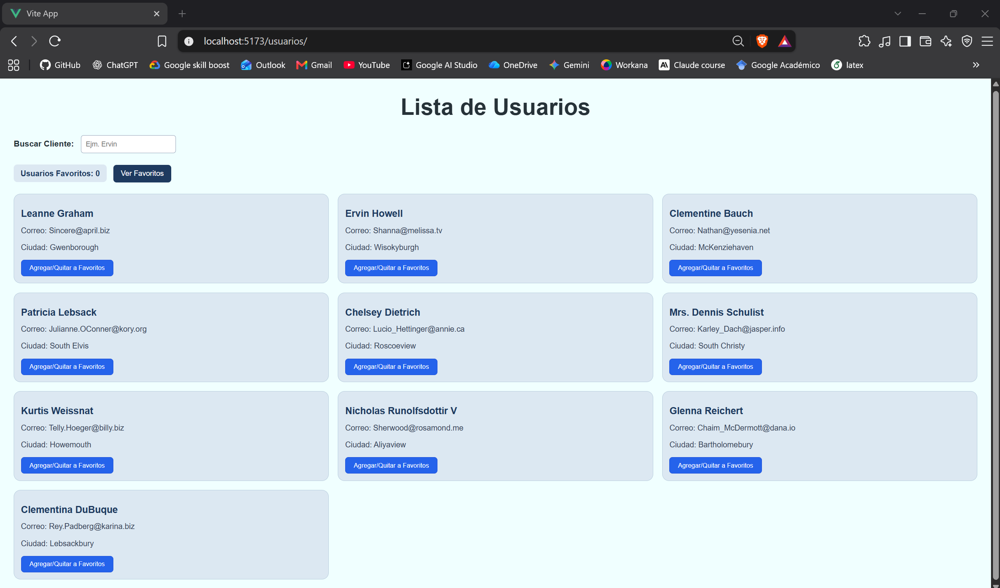
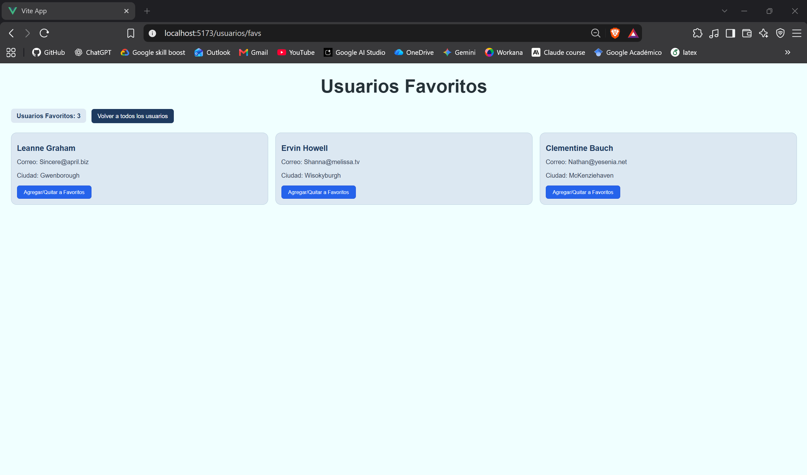
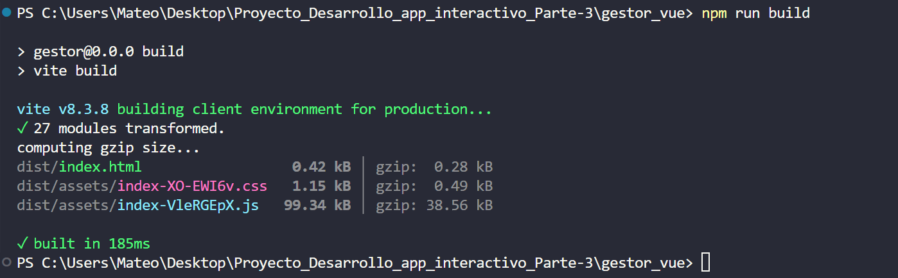

# Práctica 3 – Desarrollo de aplicación interactiva

## Introducción

En esta practica se desarrolla una aplicacion usando Vue y React, el objetivo es obtener un listado de usuarios de una API, mostrarlos y demas funcionalidades, se realizara la misma aplicacion con Vue y react

## 1. Aplicación Vue

### Creación del proyecto

Desde la carpeta general del proyecto, se utilizó el siguiente comando para crear el mismo usando Vue 3, se incluyo Vue Router, Pinia y demas herramientas utiles, quitando el codigo que viene de ejemplo.

```bash
npm create vue@latest gestor_vue -- --router --pinia --vitest --bare
```

### Comando de instalación y ejecución

Se usaron los siguientes comandos para instalar las dependecias y ejecutar la aplicación.

```bash
cd gestor_vue
npm install
npm run dev
```

**Ejecutar la prueba unitaria:**

```bash
npx vitest run
```

**Generar el build**

```bash
npm run build
```

**Comandos de Git que se uso para subir los avances**

```bash
git add .
git commit -m "Descripcion de los cambios"
git push origin main
```

### Evidencias de funcionamiento

**Figura 1. Visualización de usuarios obtenidos de la API.**



**Figura 2. Búsqueda de usuarios por nombre.**


**Figura 3. Vista de usuarios favoritos y funcionamiento del contador.**



**Figura 4. Prueba unitaria ejecutada correctamente con Vitest.**


**Figura 5. Build generado correctamente.**



