# Práctica 3 – Desarrollo de aplicación interactiva

## Introducción

En esta practica se desarrolla una aplicacion usando Vue y React, el objetivo es obtener un listado de usuarios de una API, mostrarlos y demas funcionalidades, se realizara la misma aplicacion con Vue y react.

En ambas aplicaciones se aplican funcionalidades como mostrar mensajes de cargando o de errores, ademas se traen lo usuarios de la API, se pueden buscar y se pueden agregar usuarios a un listado de favoritos que sera otra vista o pagina.

Ademas en ambas aplicaciones se  usan componentes reutilizables que reciben los datos de cada usuario y permiten gestionar si un usuario es favorito mediante eventos en el boton. También se implementaron estados con variables reactivas para actualizar las interfaces automaticamente.

## Estructura del proyecto

Se utilizó un solo repositorio de GitHub con dos carpetas principales, una para cada framework. Cada aplicacion tiene su propia estructura.

```
Proyecto_Desarrollo_app_interactivo_Parte-3/
├── gestor_vue/
│   └── src/
│       ├── components/
│       ├── router/
│       ├── services/
│       ├── stores/
│       ├── __tests__/
│       ├── App.vue
│       └── main.js
├── gestor_react/
│   └── src/
│       ├── components/
│       ├── context/
│       ├── pages/
│       ├── services/
│       ├── Tests/
│       ├── App.jsx
│       └── main.jsx
├── Capturas/
│   ├── vue/
│   └── react/
└── README.md
```

## 1. Aplicación Vue

### Creación del proyecto

Desde la carpeta general del proyecto, se utilizó el siguiente comando para crear el mismo usando Vue 3, se incluyo Vue Router, Pinia y demas herramientas utiles, quitando el codigo que viene de ejemplo.

```
npm create vue@latest gestor_vue -- --router --pinia --vitest --bare
```

### Comando de instalación y ejecución

Se usaron los siguientes comandos para instalar las dependecias y ejecutar la aplicación.

```
cd gestor_vue
npm install
npm run dev
```

**Ejecutar la prueba unitaria:**

```
npx vitest run
```

La prueba unitaria fue sobre el componente `TarjetaUsuario.vue`, se comprobo que muestre correctamente los datos del usuario que recibe

**Generar el build**

```
npm run build
```

**Comandos de Git que se uso para subir los avances**

```
git add .
git commit -m "Descripcion de los cambios"
git push origin main
```

### Evidencias de funcionamiento

#### Evidencia 1. Visualización de usuarios obtenidos de la API.


#### Evidencia 2. Búsqueda de usuarios por nombre.

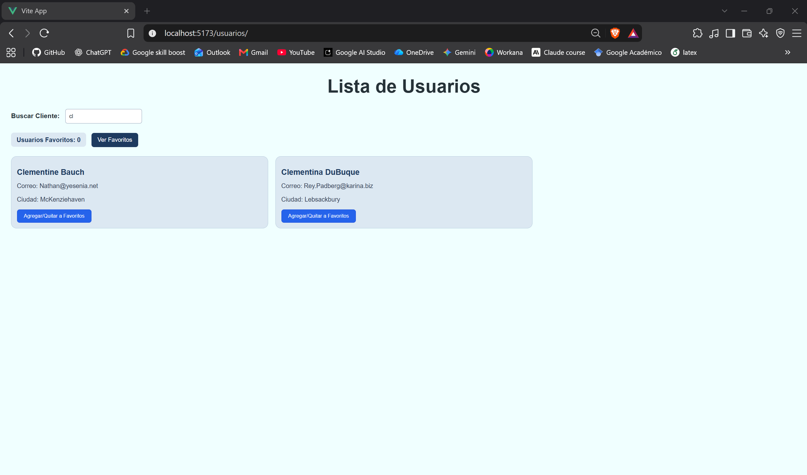

#### Evidencia 3. Vista de usuarios favoritos y funcionamiento del contador.


#### Evidencia 4. Prueba unitaria ejecutada correctamente con Vitest.

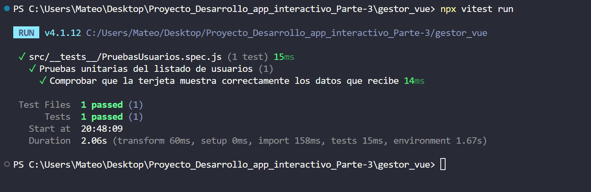

#### Evidencia 5. Build generado correctamente.


#### Evidencia 11. Mensaje de carga mientras se consultan los usuarios en Vue.

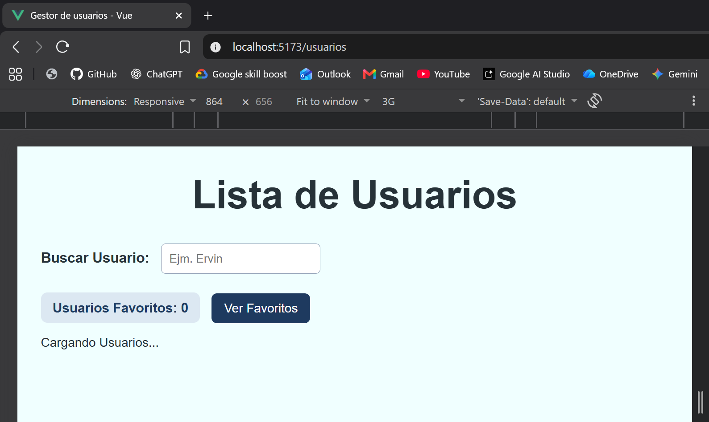

#### Evidencia 12. Manejo de errores al consultar la API en Vue.

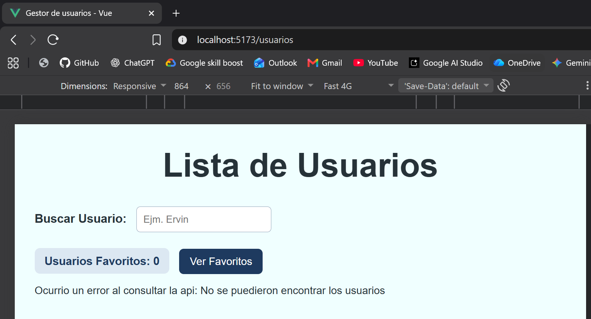

## 2. Aplicación React

### Creación del proyecto

Desde la carpeta general del proyecto se creó la aplicación utilizando React y Vite. Despues se instaló React Router para poder tener rutas para el listado general y los favoritos.

```
npm create vite@latest gestor_react -- --template react
```

**Instalación de React Router:**

```
cd gestor_react
npm install react-router-dom
```

### Comandos de instalación y ejecución

Se usaron los siguientes comandos para instalar las dependecias y ejecutar la aplicación:

```
cd gestor_react
npm install
npm run dev
```

**Instalación de las herramientas para las pruebas unitarias:**

```
npm install -D vitest jsdom @testing-library/react @testing-library/jest-dom @testing-library/user-event
```

**Comando para ejecutar la prueba unitaria:**

```
npx vitest run
```

La prueba unitaria fue sobre el componente `TarjetaUsuario.jsx`, se comprobo que muestre correctamente los datos del usuario que recibe

**Comando para generar el build:**

```
npm run build
```

**Comandos de Git que se uso para subir los avances:**

```
git add .
git commit -m "Agregar prueba unitaria de React con Vitest"
git push origin main
```

### Evidencias de funcionamiento

#### Evidencia 6. Visualización de usuarios obtenidos de la API en React.

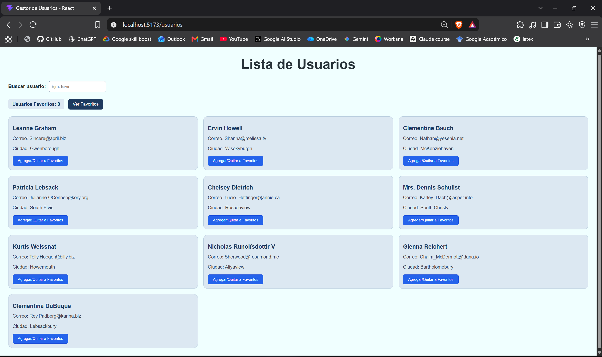

#### Evidencia 7. Búsqueda de usuarios por nombre en React.

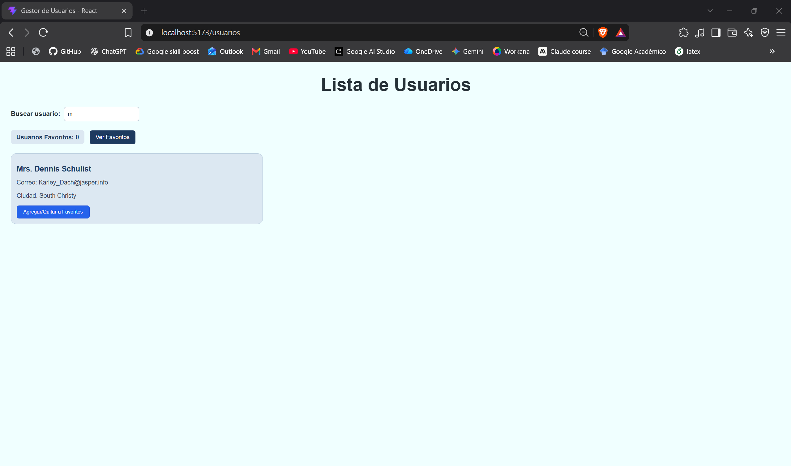

#### Evidencia 8. Vista de usuarios favoritos y funcionamiento del contador en React.

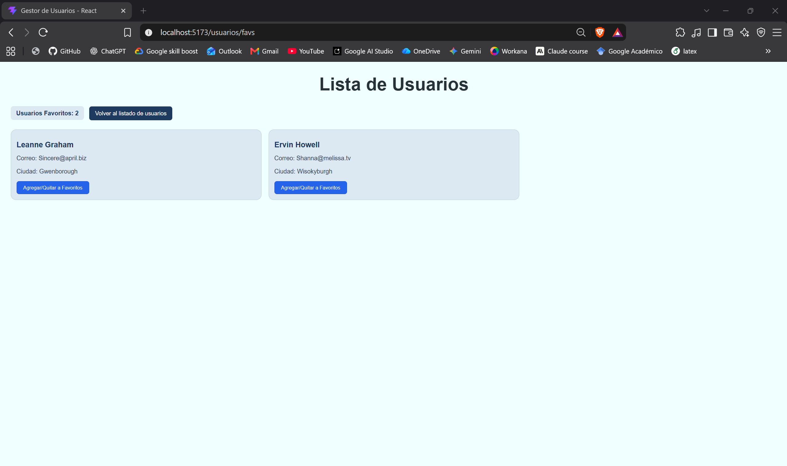

#### Evidencia 9. Prueba unitaria de React ejecutada correctamente con Vitest.

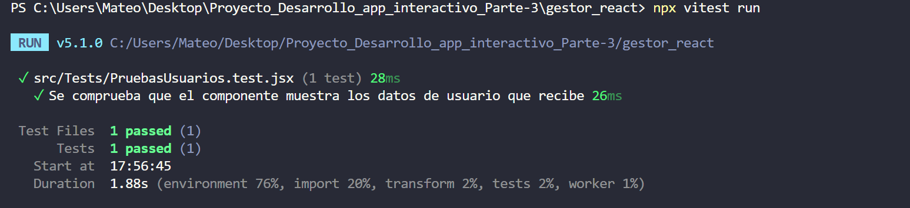

#### Evidencia 10. Build de React generado correctamente.

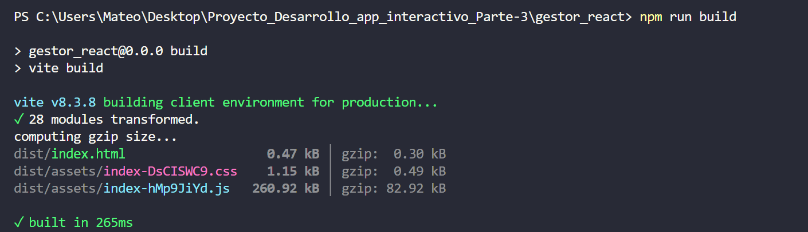

#### Evidencia 13. Mensaje de carga mientras se consultan los usuarios en React.

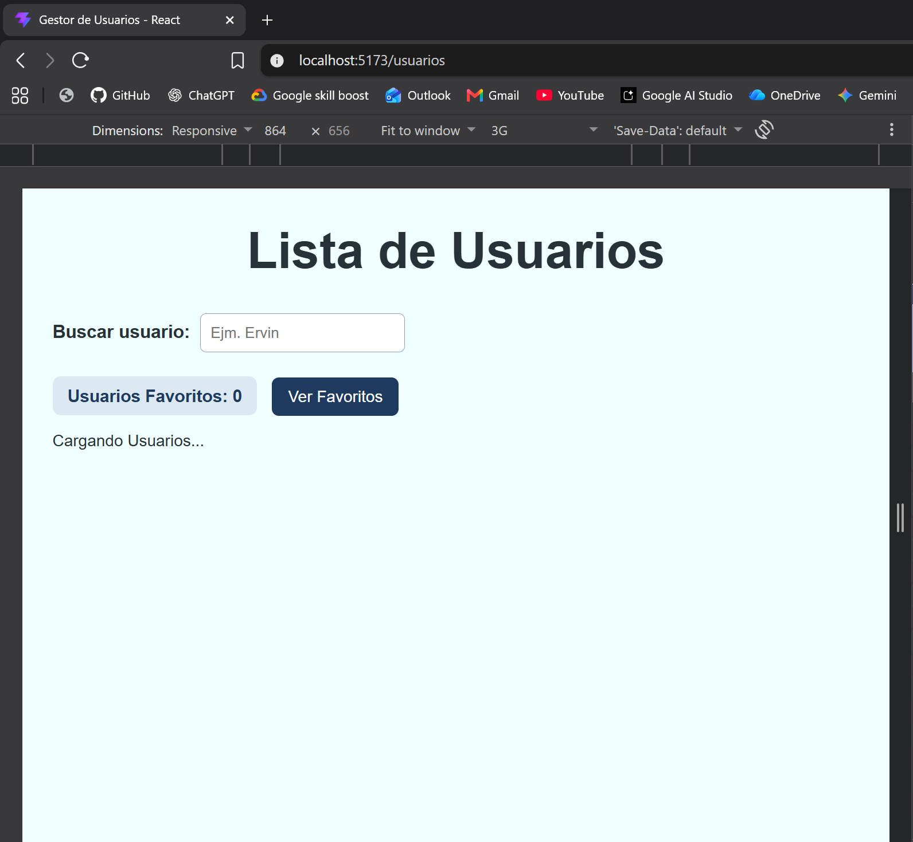

#### Evidencia 14. Manejo de errores al consultar la API en React.

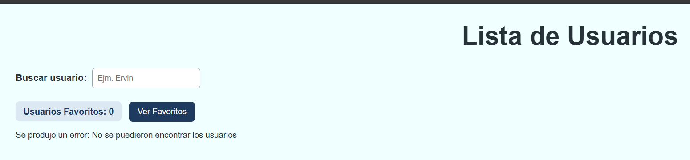